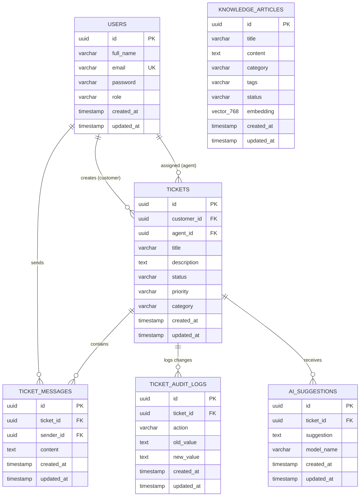

# IntelliSupport API – AI-Powered Customer Support Platform

IntelliSupport là hệ thống Backend RESTful API hiện đại cho nền tảng chăm sóc khách hàng và quản lý tri thức doanh nghiệp (Customer Support & Knowledge Management System), tích hợp Trí tuệ Nhân tạo thế hệ mới (**Generative AI / LLM - Google Gemini**) kết hợp kiến trúc **RAG (Retrieval-Augmented Generation)** và cơ sở dữ liệu vector **PostgreSQL pgvector**.

---

## 🚀 Điểm nổi bật & Công nghệ cốt lõi

- **Ngôn ngữ & Framework**: Java 25, Spring Boot 4.1.2.
- **Kiến trúc dữ liệu**:
  - PostgreSQL 17 + extension `pgvector` lưu trữ vector embeddings (768 chiều), tìm kiếm tương đồng ngữ nghĩa bằng Cosine Similarity (`<=>`) với chỉ mục HNSW (`vector_cosine_ops`).
  - Định danh thực thể toàn bộ bằng **UUID v4** (`gen_random_uuid()`).
  - ORM: Hibernate 7.4.x với module chính thức `hibernate-vector`.
  - Quản lý phiên bản CSDL tự động qua **Flyway Migration**.
- **Bảo mật & Phân quyền (RBAC)**:
  - Spring Security 7 kết hợp Stateless JWT Authentication (`io.jsonwebtoken 0.12.6`).
  - Mã hóa mật khẩu an toàn với `BCryptPasswordEncoder`.
  - Phân quyền 3 cấp độ: `ADMIN`, `AGENT` (nhân viên hỗ trợ), `CUSTOMER` (khách hàng).
- **Tích hợp Generative AI & RAG**:
  - Tự động phân loại danh mục (`Category`) và phát hiện mức độ ưu tiên (`Priority`) của ticket khi khách hàng tạo yêu cầu.
  - Tự động vector hóa nội dung bài viết và truy vấn bằng mô hình nhúng (`gemini-embedding-001`).
  - RAG Pipeline: Tìm kiếm tri thức nội bộ liên quan nhất để đưa vào ngữ cảnh cho Gemini LLM đề xuất câu trả lời chuẩn xác.
  - Cơ chế tự phục hồi: Tích hợp công cụ phân tích ngôn ngữ tự nhiên offline (heuristic NLP & token hash projection) nếu mất kết nối API Gemini.
- **Quản lý dữ liệu hàng loạt**:
  - Tạo file template Excel (.xlsx) chuẩn hóa với dropdown validation (Apache POI 5.3.0).
  - API import hàng loạt tài liệu tri thức từ Excel kèm tự động sinh vector embedding và báo cáo chi tiết lỗi từng dòng.
- **Tài liệu hóa API**:
  - Swagger UI / OpenAPI 3.0 tích hợp sẵn tại `/swagger-ui.html`.

---

## 🏛️ Kiến trúc Cơ sở Dữ liệu



---

## 🔄 Vòng đời Trạng thái Ticket (State Machine)

Hệ thống kiểm soát chặt chẽ luồng chuyển đổi trạng thái bằng logic nghiệp vụ backend:

```text
       ┌──────────────┐
       │     OPEN     │ (Khách hàng tạo ticket)
       └──────┬───────┘
              │ (Agent nhận việc / trả lời)
              ▼
       ┌──────────────┐
  ┌───►│ IN_PROGRESS  │◄───┐
  │    └──────┬───────┘    │
(Khách        │            │ (Khách hàng
phản hồi)     ▼            │  trả lời tiếp)
  │    ┌──────────────┐    │
  └────┤WAITING_CUSTOM├────┘
       └──────┬───────┘
              │ (Vấn đề đã xong)
              ▼
       ┌──────────────┐
       │   RESOLVED   │
       └──────┬───────┘
              │ (Khách hàng / Admin đóng)
              ▼
       ┌──────────────┐
       │    CLOSED    │ (Kết thúc - không thể gửi tin nhắn mới)
       └──────────────┘
```

---

## 📂 Cấu trúc Thư mục Dự án

```
intellisupport_api/
├── src/
│   ├── main/
│   │   ├── java/com/intellisupport/
│   │   │   ├── common/                  # Các tiện ích chung, Enum, Entity cơ sở, Exception handler
│   │   │   │   ├── entity/              # BaseEntity (UUID, timestamps)
│   │   │   │   ├── enums/               # UserRole, TicketStatus, TicketPriority, TicketCategory...
│   │   │   │   ├── exception/           # GlobalExceptionHandler & custom AppException
│   │   │   │   ├── response/            # Chuẩn phản hồi ApiResponse<T>, PageResponse<T>
│   │   │   │   └── util/                # SecurityUtils, PaginationUtils...
│   │   │   ├── config/                  # SecurityConfig, OpenAPI Swagger config...
│   │   │   ├── domain/
│   │   │   │   ├── auth/                # Xác thực JWT, Login, Register
│   │   │   │   ├── user/                # Quản lý tài khoản người dùng và nhân viên
│   │   │   │   ├── ticket/              # Quản lý Ticket, Phân công, Hội thoại và Audit Log
│   │   │   │   ├── knowledge/           # Kho tri thức Knowledge Base, RAG index, Import/Export Excel
│   │   │   │   └── ai/                  # Client Gemini LLM, Embedding Service, RAG Engine
│   │   │   └── IntellisupportApiApplication.java
│   │   └── resources/
│   │       ├── db/migration/            # Flyway scripts (V1 schema, V2 seed admin)
│   │       ├── application.properties
│   │       ├── application-dev.properties
│   │       └── application-prod.properties
├── pom.xml                              # Khai báo Maven dependencies & plugins
├── run-dev.sh                           # Script khởi chạy môi trường phát triển
└── README.md
```

---

## 📑 Danh mục RESTful APIs

### 1. Authentication (`/api/v1/auth`)
| Method | Endpoint | Quyền hạn | Mô tả |
|---|---|---|---|
| `POST` | `/api/v1/auth/register` | Public | Đăng ký tài khoản khách hàng (`CUSTOMER`) |
| `POST` | `/api/v1/auth/login` | Public | Đăng nhập hệ thống, nhận Bearer JWT Token |

### 2. User Management (`/api/v1/users`)
| Method | Endpoint | Quyền hạn | Mô tả |
|---|---|---|---|
| `GET` | `/api/v1/users/me` | Authenticated | Lấy thông tin cá nhân của tài khoản đang đăng nhập |
| `POST` | `/api/v1/users` | `ADMIN` | Admin tạo tài khoản nhân viên (`AGENT` / `ADMIN`) |

### 3. Ticket Management (`/api/v1/tickets`)
| Method | Endpoint | Quyền hạn | Mô tả |
|---|---|---|---|
| `POST` | `/api/v1/tickets` | Authenticated | Tạo yêu cầu hỗ trợ mới (**AI tự động phân loại Category và Priority**) |
| `GET` | `/api/v1/tickets` | Authenticated | Danh sách ticket có phân trang, lọc theo status, priority, category |
| `GET` | `/api/v1/tickets/{id}` | Authenticated | Xem chi tiết ticket, luồng tin nhắn và lịch sử thay đổi (Audit Log) |
| `PATCH`| `/api/v1/tickets/{id}/status` | Authenticated | Cập nhật trạng thái ticket theo quy tắc State Machine |
| `PATCH`| `/api/v1/tickets/{id}/assign` | `AGENT`, `ADMIN` | Phân công nhân viên xử lý ticket |
| `POST` | `/api/v1/tickets/{id}/messages` | Authenticated | Gửi tin nhắn phản hồi trong ticket |
| `GET` | `/api/v1/tickets/{id}/messages` | Authenticated | Xem toàn bộ lịch sử tin nhắn của ticket |

### 4. Knowledge Base & Excel Management (`/api/v1/knowledge`)
| Method | Endpoint | Quyền hạn | Mô tả |
|---|---|---|---|
| `GET` | `/api/v1/knowledge` | Authenticated | Danh sách bài viết tri thức (Khách hàng chỉ xem `PUBLISHED`) |
| `POST` | `/api/v1/knowledge` | `AGENT`, `ADMIN` | Tạo bài viết tri thức và tự động tạo vector embedding |
| `GET` | `/api/v1/knowledge/template` | `AGENT`, `ADMIN` | Tải xuống file Excel template (.xlsx) chuẩn có dropdown list |
| `POST` | `/api/v1/knowledge/import` | `AGENT`, `ADMIN` | Upload Excel (.xlsx) để import hàng loạt bài viết kèm vectorization |

### 5. AI Assistant & RAG (`/api/v1/ai`)
| Method | Endpoint | Quyền hạn | Mô tả |
|---|---|---|---|
| `POST` | `/api/v1/ai/analyze-ticket` | Authenticated | Phân tích nội dung ticket: tóm tắt, đề xuất danh mục & độ ưu tiên |
| `POST` | `/api/v1/ai/suggest-reply` | `AGENT`, `ADMIN` | RAG đề xuất câu trả lời cho nhân viên dựa trên kho tài liệu |
| `POST` | `/api/v1/ai/ask` | Authenticated | Hỏi đáp trực tiếp với trợ lý ảo AI qua tìm kiếm ngữ nghĩa Knowledge Base |

---

## ⚙️ Cài đặt & Khởi chạy

### 1. Yêu cầu môi trường
- **Java**: Phiên bản 21 trở lên (khuyến nghị Java 25).
- **PostgreSQL**: Phiên bản 15+ (đã cài đặt extension `pgvector`).
- **Google Gemini API Key**: Lấy từ [Google AI Studio](https://aistudio.google.com/).

### 2. Thiết lập Biến môi trường
Cấu hình trong file môi trường `.env` hoặc file cấu hình hệ điều hành:

```env
SERVER_PORT=8081
DB_HOST=localhost
DB_PORT=5432
DB_NAME=intellisupport
DB_USERNAME=postgres
DB_PASSWORD=your_postgres_password

JWT_SECRET=404E635266556A586E3272357538782F413F4428472B4B6250645367566B5970
JWT_EXPIRATION_MS=86400000
JWT_REFRESH_EXPIRATION_MS=604800000

CORS_ALLOWED_ORIGINS=http://localhost:3000,http://localhost:5173

GEMINI_API_KEY=your_gemini_api_key
GEMINI_MODEL=gemini-2.5-flash
GEMINI_EMBEDDING_MODEL=gemini-embedding-001
```

### 3. Khởi động ứng dụng
Chạy trực tiếp bằng script phát triển:
```bash
./run-dev.sh
```

Hoặc sử dụng Maven Wrapper:
```bash
./mvnw clean spring-boot:run
```

Khi ứng dụng khởi động thành công:
- **API Base URL**: `http://localhost:8081`
- **Swagger UI**: `http://localhost:8081/swagger-ui.html`
- **Tài khoản quản trị mặc định (Seed Data)**:
  - Email: `admin@intellisupport.com`
  - Password: `Admin@123`
